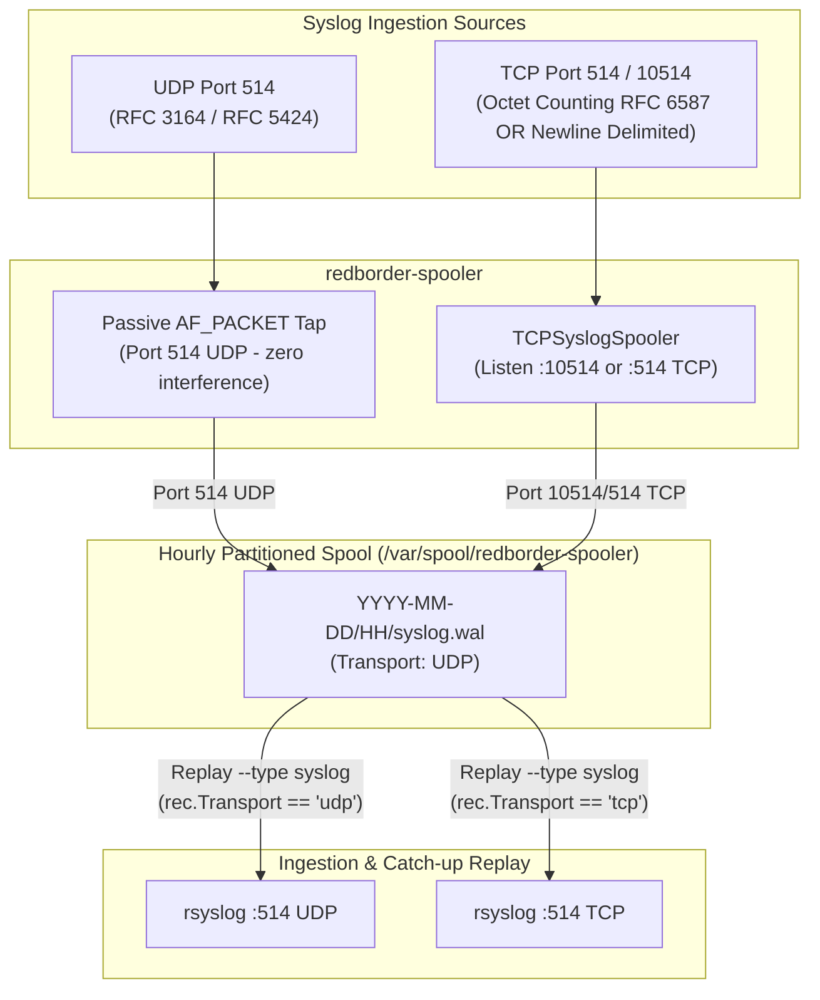

# Syslog Integration Guide (rsyslog + redborder-spooler)

This document describes how `redborder-spooler` integrates with `rsyslog` (and RFC 3164 / RFC 5424 / RFC 6587 Syslog sources) to ensure **zero log loss** during redBorder maintenance windows, platform upgrades, or service restarts.

---

## Architecture Overview

Syslog arrives via two distinct transports:



### 1. UDP Syslog (Port 514)
- **Passive Capture via AF_PACKET**: Captured passively on port 514 alongside NetFlow (2055) and sFlow (6343).
- **Non-Intrusive**: Does not bind to the UDP socket or conflict with a running `rsyslogd` process on port 514.
- **Stored in `syslog.wal`**: Ingested directly into `syslog.wal` as a Syslog record with transport `udp`, incrementing `SYSLOG MSGS` in `list` and `status`. Flow telemetry (`udp.wal`) remains cleanly separated as `TRAFFIC PKTS` / `TRAFFIC BYTES`.
- **Replay**: Replayed as raw UDP datagrams to `--syslog-target` (default port 514) without RBRP encapsulation.

### 2. TCP Syslog (RFC 6587 & Delimited Streams)
- **Dedicated Spooler (`TCPSyslogSpooler`)**: Listens on configured TCP port (default `:10514`, or `:514` during maintenance windows).
- **Framing Support**:
  - Handles traditional `\n` or `\r\n` delimited streams.
  - Automatically handles **RFC 6587 octet counting** (e.g. `<length> <message>`).
- **Feedback Loop Protection**: Messages carrying `X-Redborder-Replay` or marked as replay are automatically dropped to prevent replay feedback loops.
- **Optional Upstream Forwarding**: If `upstream_addr` is configured, raw messages are forwarded asynchronously to upstream destinations with low latency.
- **Stored in `syslog.wal`**: Stored with transport `tcp`, timestamp, client IP, message length, CRC32, and payload. Replayed over TCP with `X-Redborder-Replay: true` marker.

---

## Operating Modes: Normal vs Maintenance Window

### Mode A: Normal Operation (Continuous Recording)
- `rsyslog` runs normally and binds to UDP/TCP port 514.
- `rb-spooler` captures UDP port 514 passively via raw `AF_PACKET` socket tap.
- For TCP syslog, external proxies or syslog relays tee traffic to `rb-spooler` on port 10514 (`capture.syslog_tcp.listen_addr: ":10514"`).

### Mode B: Maintenance Window (rsyslog Upgrade / Maintenance)
When `rsyslog` or downstream ingestion (`x2kafka`, Kafka, Druid) must be stopped for updates:
1. **UDP Traffic**: Continues to be captured passively by `rb-spooler` without any downtime or dropped datagrams.
2. **TCP Traffic (Zero Config Edit via Socket)**:
   - Configure `capture.syslog_tcp.listen_addr: ":514"` in `/etc/redborder-spooler/config.yaml` with `enabled: false`.
   - When starting maintenance, stop `rsyslog` and send the dynamic control command:
     ```bash
     rb-spooler ctl enable syslog_tcp
     ```
     `rb-spooler` immediately binds `:514` TCP and buffers all incoming TCP syslog streams directly into `syslog.wal`. Chef runs in the background will not overwrite active state since `config.yaml` is not touched.
   - Once maintenance is finished, release `:514` and restart `rsyslog`:
     ```bash
     rb-spooler ctl disable syslog_tcp
     systemctl start rsyslog
     ```
3. **Catch-up Replay**: Once `rsyslog` is back online, replay buffered messages:
   ```bash
   # Replay buffered Syslog records (UDP records to UDP port 514, TCP records to TCP port 514)
   rb-spooler replay --from "2026-11-25 10:00" --type syslog --syslog-target 127.0.0.1:514 --speed 10x -y
   ```

---

## Option: Nginx Stream Reverse Proxy Configuration (Transparent Failover)

Just like HTTP can fail over to `rb-spooler` using Nginx HTTP upstream `backup`, TCP Syslog can be configured with **Nginx Stream** (`ngx_stream_core_module`) for transparent zero-loss failover:

### Nginx Stream Configuration (`/etc/nginx/conf.d/syslog_stream.conf`)
```nginx
# Add inside or include from the 'stream { ... }' block in /etc/nginx/nginx.conf
stream {
    upstream rsyslog_cluster {
        server 127.0.0.1:10514 max_fails=3 fail_timeout=5s; # Primary: rsyslogd
        server 127.0.0.1:20514 backup;                       # Backup: rb-spooler
    }

    server {
        listen 514;
        proxy_pass rsyslog_cluster;
        proxy_connect_timeout 2s;
        proxy_timeout 1h;
    }
}
```

### Spooler Configuration (`/etc/redborder-spooler/config.yaml`)
```yaml
capture:
  interfaces:
    - "any"
  udp_ports:
    - 2055
    - 6343
    - 514
  mode: "af_packet"
  syslog_tcp:
    enabled: true
    listen_addr: ":20514"
```

* **When `rsyslogd` (listening on 10514) is healthy**: All TCP connections flow to `rsyslogd`.
* **When `rsyslogd` is stopped for upgrade**: Nginx transparently shifts new TCP connections to `rb-spooler` on `:20514`, buffering incoming logs into `syslog.wal`.
* **After upgrade**: Restart `rsyslogd` and run `rb-spooler replay --type syslog --syslog-target 127.0.0.1:10514 -y`.

---

## Verification Commands

Use standard Linux `logger` utilities to verify and test Syslog spooling and replay.

### 1. Verify UDP Syslog Capture
Send UDP Syslog datagrams using `logger -d` (datagram / UDP):
```bash
logger -d -n 127.0.0.1 -P 514 "test UDP syslog message from logger"
```

Verify recording:
```bash
rb-spooler list
rb-spooler replay --from "2026-11-25 10:00" --type syslog --speed 0
```

### 2. Verify TCP Syslog Spooler (Port 10514 or 514)
Send TCP Syslog streams using `logger -T` (TCP):
```bash
logger -T -n 127.0.0.1 -P 10514 "test TCP syslog newline message from logger"
```

Test RFC 6587 octet-counted frame using `nc` or `bash`:
```bash
# Format: <length> <message>
MSG="<14>Nov 25 12:00:00 host app: test RFC 6587 octet counting"
LEN=${#MSG}
printf "%d %s" "$LEN" "$MSG" | nc -w 1 127.0.0.1 10514
```

Verify stored Syslog messages:
```bash
rb-spooler status
rb-spooler list -v
```

Replay spooled Syslog messages back to rsyslog on port 514:
```bash
rb-spooler replay --from "2026-11-25 10:00" --type syslog --syslog-target 127.0.0.1:514 --speed 5x
```

### 3. Loopback Replay & Sensor IP Injection

When replaying buffered Syslog to a local `rsyslog` instance on `127.0.0.1:514`, the operating system socket layer sets `$fromhost-ip` to `127.0.0.1`. In multi-sensor redBorder deployments where `rsyslog` rules route messages based on the sensor IP address, `rb-spooler replay` automatically injects the recorded client IP (`rec.ClientIP`) as the Syslog hostname (`--syslog-inject-client-ip=true`, enabled by default):
- **RFC 3164**: `<14>Nov 25 14:13:00 10.1.33.158 app: ...`
- **RFC 5424**: `<165>1 2026-11-25T14:13:00Z 10.1.33.158 app ...`

In `rsyslog`, rules matching on either `$fromhost-ip` (live traffic) or `($fromhost-ip == '127.0.0.1' and $hostname == '<sensor_ip>')` (replayed traffic) match cleanly and preserve per-sensor isolation:
```syslog
if ($fromhost-ip == '10.1.33.158') or ($fromhost-ip == '127.0.0.1' and ($hostname == '10.1.33.158' or $hostname == 'vaultD')) then {
    action(type="omkafka" topic="rb_vault" broker="kafka.service:9092" template="vaultD_...")
    stop
}
```
